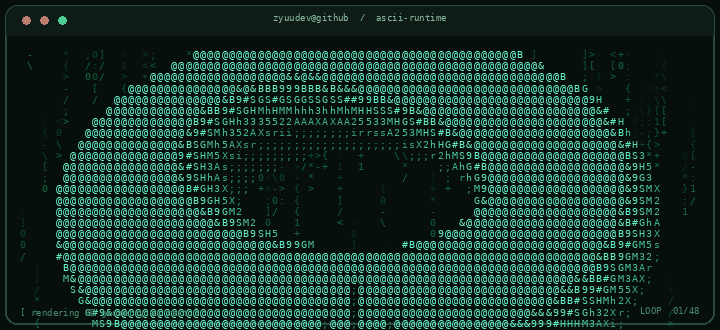

<div align="center">
  
</div>

<table>
  <tr>
    <td width="50%" valign="middle">
      <pre>
zyuudev@github:~$ whoami

Name      : Arrasyd Nanda Fairuz
Role      : Full-Stack Developer
Focus     : AI Engineering & IoT
Location  : Yogyakarta, Indonesia
Education : Software Engineering (RPL)

zyuudev@github:~$ status

Building practical products.
Learning by experimenting.
Improving by shipping.
      </pre>
    </td>
    <td width="50%" valign="middle">
      <h3>Hey, I'm Fairuz 👋</h3>
      <p>
        I'm a Software Engineering student who enjoys turning ideas into useful
        digital products. I work across frontend, backend, APIs, and databases,
        while exploring AI-powered systems and connected devices.
      </p>
      <p>
        I care about solving real problems, understanding how systems work
        beneath the interface, and building projects that go beyond prototypes.
      </p>
      <p>
        <strong>Currently:</strong> Growing as a full-stack developer and working
        toward becoming an AI engineer.
      </p>
      <p>
        <a href="https://github.com/ZyuuDev">GitHub</a> ·
        <a href="mailto:zyuudev@gmail.com">Email</a> ·
        <a href="https://instagram.com/nndaaaaxy_">Instagram</a>
      </p>
    </td>
  </tr>
</table>

---

### `$ cat /about/current-focus.txt`

- **AI Engineering** — learning to build AI agents, retrieval systems, and reliable AI-powered workflows.
- **Backend Engineering** — designing REST APIs, authentication, database structures, and maintainable services.
- **Full-Stack Development** — building complete products with thoughtful UI, backend logic, and deployment.
- **IoT & Applied Technology** — connecting software, sensors, and real-world problems through practical prototypes.

### `$ ls ~/projects --featured`

| Project | What it does |
|:--|:--|
| [Sentinel AI](https://github.com/ZyuuDev/Sentinel-AI) | An AI-assisted code analysis and repair platform, combining retrieval, agent workflows, patching, and testing. |
| [ZyuuBotz V3](https://github.com/ZyuuDev/ZyuuBotz-V3) | WhatsApp bot core focused on automation, extensibility, and service development. |
| [SASMITA LENS](https://github.com/ZyuuDev/FIKSI-SasmitaLens) | An IoT fruit-ripeness scanner that analyzes tapping sounds with a microphone and AI. |
| [Finspire](https://github.com/ZyuuDev/Finspire-JHIC-DB) | A financial-education application designed to make money management easier to understand. |
| [E-Teller Bank Mini](https://github.com/ZyuuDev/UKK_E-Teller_Bank_Mini_ArrasydNandaFairuz) | A school mini-bank information system with role-based access and teller workflows. |
| [Taman Bhinneka](https://github.com/ZyuuDev/Project_Taman_Bhinneka_UGM) | An interactive digital exhibition experience for exploring Indonesian culture. |

### `$ cat ~/toolbox.txt`

<table>
  <tr>
    <td><strong>Languages</strong></td>
    <td>JavaScript · TypeScript · Python · PHP · Dart · SQL</td>
  </tr>
  <tr>
    <td><strong>Frontend</strong></td>
    <td>React · Vite · Tailwind CSS</td>
  </tr>
  <tr>
    <td><strong>Backend</strong></td>
    <td>FastAPI · Laravel · Node.js · Express</td>
  </tr>
  <tr>
    <td><strong>Data</strong></td>
    <td>PostgreSQL · MySQL · SQLite · pgvector</td>
  </tr>
  <tr>
    <td><strong>Tools</strong></td>
    <td>Git · GitHub Actions · Docker · Linux · Figma</td>
  </tr>
</table>

### `$ tail -n 3 ~/learning.log`

```text
[ongoing] Python, FastAPI, and AI system design
[ongoing] Agentic workflows, RAG, and evaluation
[ongoing] Backend architecture, security, and deployment
```

### `$ ./recognition`

🏆 **Provincial Winner — FIKSI 2026, Agribusiness** · SASMITA LENS

---

### `$ ./github-stats`

<p align="center">
  
  
</p>

<p align="center">
  
</p>

---

### `$ ./connect`

<p align="center">
  <a href="https://github.com/ZyuuDev">GitHub</a> ·
  <a href="mailto:zyuudev@gmail.com">zyuudev@gmail.com</a> ·
  <a href="https://instagram.com/nndaaaaxy_">@nndaaaaxy_</a>
</p>

<p align="center"><sub>Curious by nature. Built one commit at a time.</sub></p>
