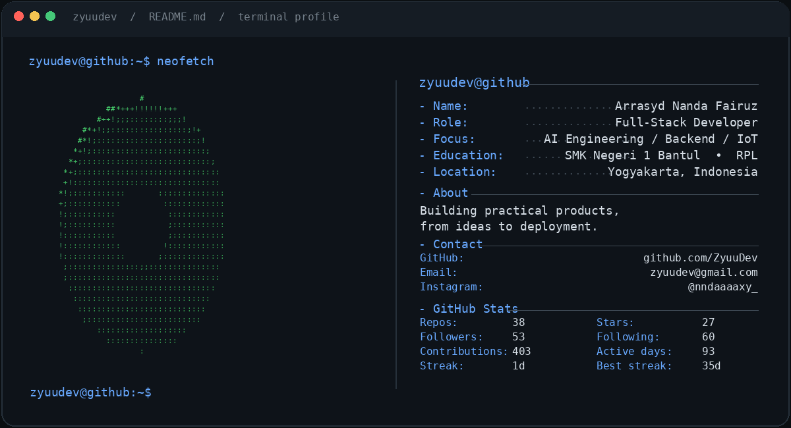
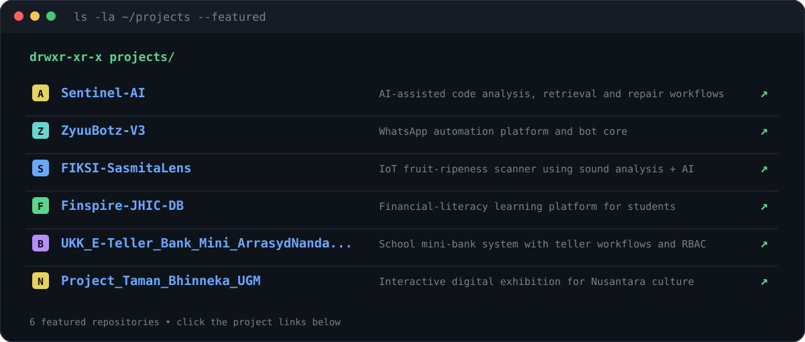
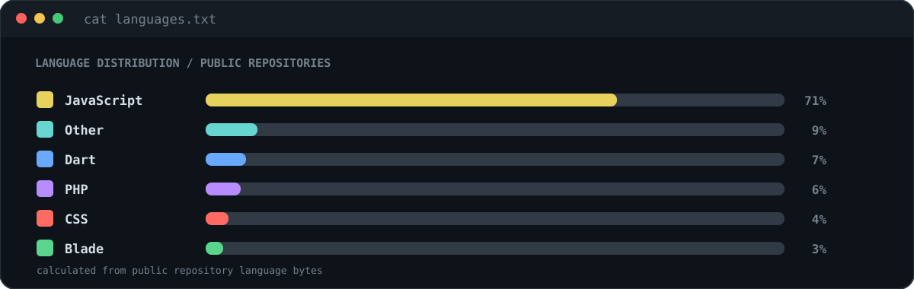
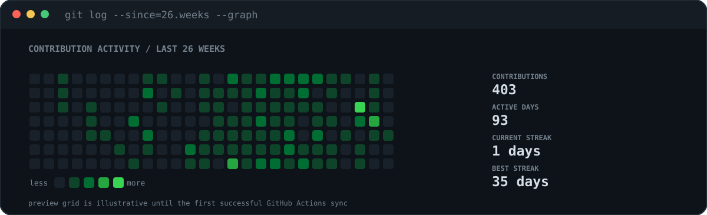

  

### Hi there, I'm **Arrasyd Nanda Fairuz** 👋
**Fullstack Web Developer (Learner)** • **Backend / API Builder** • **Cybersecurity & AI Enthusiast**

🎓 *Student at **SMK Negeri 1 Bantul** — Major in **Software Engineering (RPL)**.*  
I build practical, end-to-end digital solutions: **UI → API → Database → Deployment**.

<i>Goal:</i> to contribute as an <b>intern / junior developer</b> in a <b>Web Development</b> team while continuously improving.

---

### `$ ls ~/projects --featured`

  

  <a href="https://github.com/ZyuuDev/Sentinel-AI"><b>Sentinel AI</b></a> ·
  <a href="https://github.com/ZyuuDev/ZyuuBotz-V3"><b>ZyuuBotz V3</b></a> ·
  <a href="https://github.com/ZyuuDev/FIKSI-SasmitaLens"><b>SASMITA LENS</b></a> ·
  <a href="https://github.com/ZyuuDev/Finspire-JHIC-DB"><b>Finspire</b></a> ·
  <a href="https://github.com/ZyuuDev/UKK_E-Teller_Bank_Mini_ArrasydNandaFairuz"><b>E-Teller Bank Mini</b></a> ·
  <a href="https://github.com/ZyuuDev/Project_Taman_Bhinneka_UGM"><b>Taman Bhinneka</b></a>

  🏆 <b>Achievements:</b> 
  🥉 <b>3rd Place National Winner</b> — Jagoan Hosting Innovation Competition 2.0 · <i>Finspire</i> 
  🥇 <b>1st Place Provincial Winner</b> — FIKSI 2026, Agribusiness · <i>SASMITA LENS</i> 
  🥈 <b>1st Runner-Up Provincial Winner</b> — CCA Islam 2019 
  🥉 <b>3rd Place Provincial Winner</b> — IRM Jambidan Kids Festival 2020 (Angklung Group)

---

### `$ cat /about/profile.txt`

🎓 <b>Student at SMK N 1 Bantul</b> — Major in <b>Software Engineering (RPL)</b>  
💡 Focus: <b>Fullstack Web Development</b>, <b>Backend Architecture</b>, and fundamentals of <b>Cybersecurity & AI</b>  
🧩 Enjoy building end-to-end applications: <b>UI</b> → <b>API</b> → <b>Database</b> → <b>Deployment</b>  
📌 Work style: <b>fast learner</b>, <b>organized</b>, <b>consistent</b>, with strong interest in documentation and clean code  
🧐 Fun fact: <b>I love chicken noodle soup (mie ayam)</b> 🍜

#### 🔭 Current Learning Focus
- 🔭 **Fullstack Mini-Projects:** Building portfolio projects with public repositories and well-structured READMEs
- 🧠 **Backend Mastery:** Deepening skills in REST API design, JWT/OAuth authentication, and database optimization
- 🛡️ **Cybersecurity:** Learning web application security fundamentals, OWASP Top 10, and vulnerability assessment
- 🤖 **AI Engineering & IoT:** Exploring agentic workflows, RAG, and sensor integrations

#### 💼 What I Can Help With
- Building responsive web interfaces using **React, Vue, Next.js, Nuxt**, and **Tailwind CSS**
- Developing robust REST APIs with **Node.js/Express, FastAPI, Laravel**, and **NestJS**
- Implementing CRUD workflows, authentication (JWT/OAuth), and database schemas (**MySQL, PostgreSQL, MongoDB, SQLite**)
- Setting up deployment (**Vercel, Netlify, Docker**) and CI/CD pipelines (**GitHub Actions**)

---

### `$ cat ~/toolbox.txt`

> Technologies I have used or am currently actively learning and exploring. 🚀

#### Languages & Fundamentals

  

#### Frontend

  

#### Backend & Database

  

#### DevOps, Cloud & Tools

  

#### Cybersecurity (Learning)

  
  
  
  
  
  

---

### `$ ./github-stats`

  

  

  <picture>
    <source media="(prefers-color-scheme: dark)" srcset="https://raw.githubusercontent.com/ZyuuDev/ZyuuDev/output/pacman-contribution-graph-dark.svg">
    <source media="(prefers-color-scheme: light)" srcset="https://raw.githubusercontent.com/ZyuuDev/ZyuuDev/output/pacman-contribution-graph.svg">
    
  </picture>

  

---

### `$ ./connect`

  
  
  
  

  📍 <b>Location:</b> Yogyakarta, Indonesia &nbsp;•&nbsp;
  🕒 <b>Availability:</b> Open for internships, freelance, and part-time opportunities

Arrasyd Nanda Fairuz · Built with curiosity, shipped one commit at a time.

